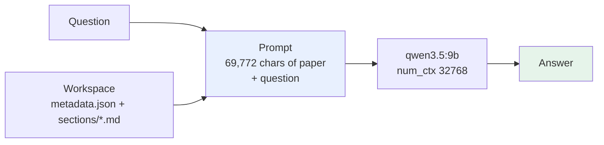
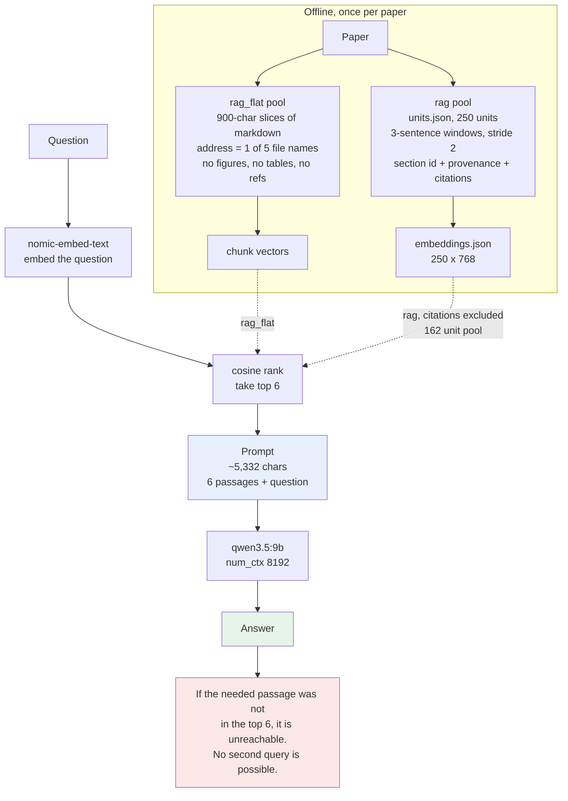
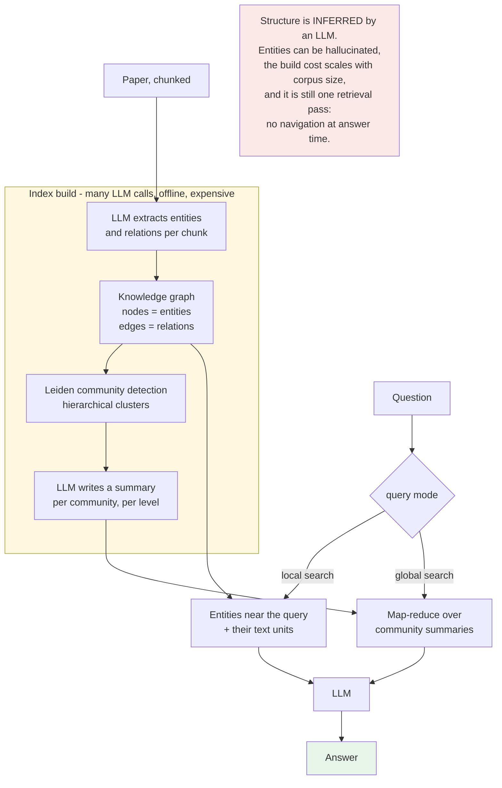
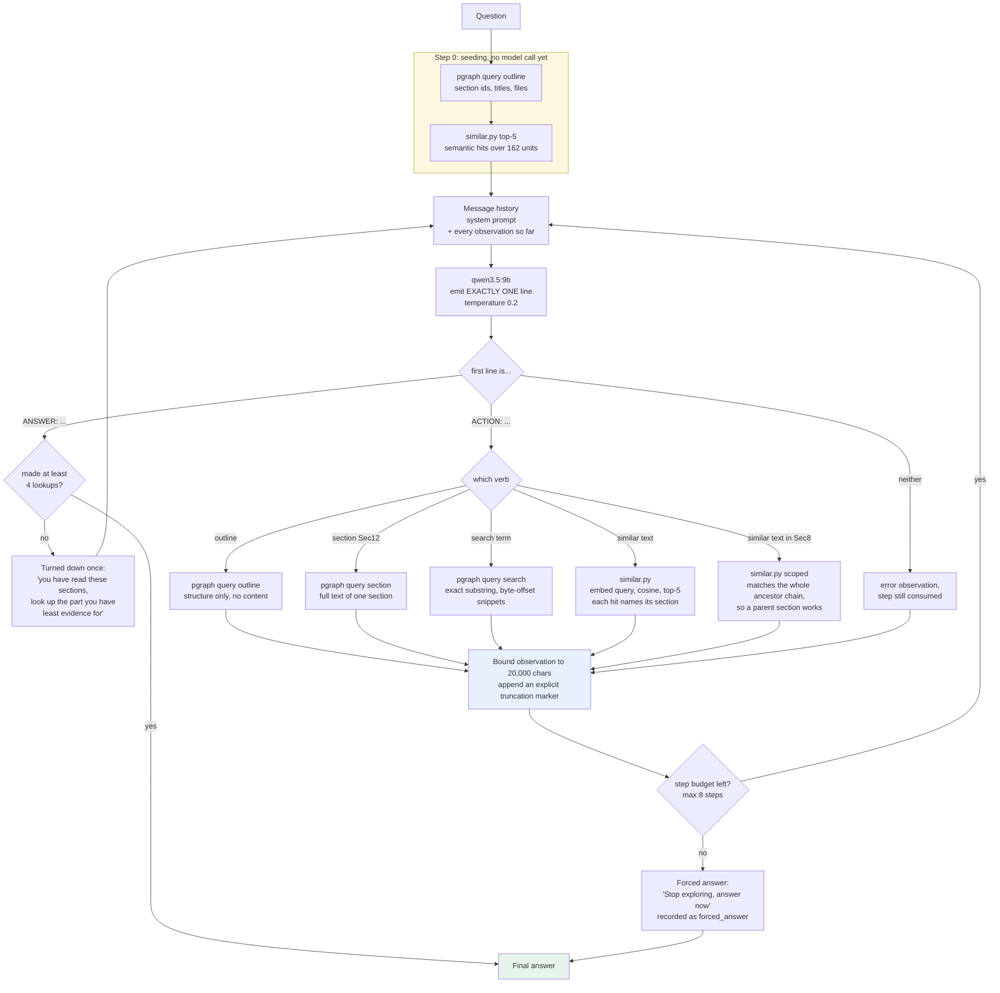
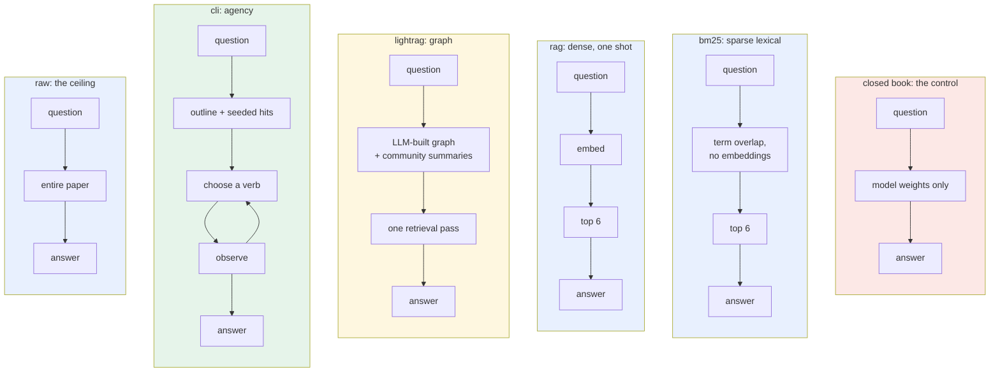
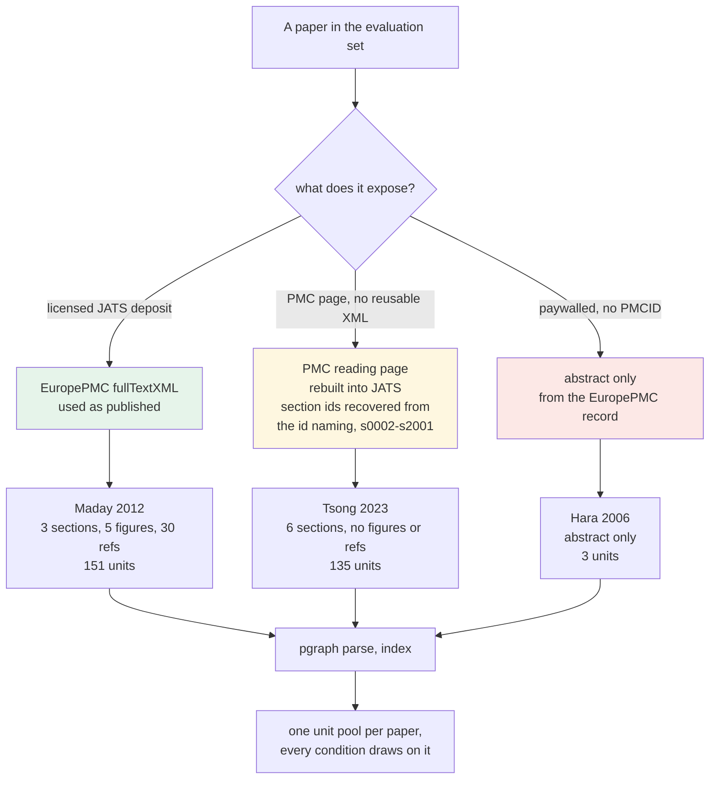

# Four ways to answer a question about one paper

Each diagram below is a standalone Mermaid block. Paste one at a time into
https://mermaid.live to view it.

Three of the four are implemented and measured in this repo. GraphRAG is drawn
as a reference baseline from the published method and has **not** been built or
run here; its diagram is marked accordingly.

---

## 1. raw - whole paper in context

No retrieval. The paper is flattened to text and handed over in full.

Nothing can be missed for lack of reaching it, so this is the coverage ceiling.
It is also the cost ceiling, and it stops working the moment a paper does not
fit the context window.

---

## 2. rag - top-k, one shot, no agency

One embedding of the question, one ranking, one generation. Two variants differ
only in what the pool is made of.

The red box is the whole story of RAG's deficit on the PMC11289285 corpus:
**32% of its facet-runs are navigation misses**, versus 3% generation misses.

It is not the story everywhere. On the Graph RAG MVP's Type A questions, where
the answer is one explicit sentence, RAG's navigation misses are **0%** and it
ties every other retrieval system. One-shot top-k fails when a question has
several parts, not when it has one.

---

## 3. GraphRAG - reference baseline, NOT implemented here

Drawn from the published method so the comparison is honest about what it does.
Nothing in this repo builds or runs it.

The contrast worth naming in a meeting: GraphRAG spends LLM calls up front to
*guess* a structure. A JATS paper already ships with its structure - sections,
subsections, figures, tables, provenance, citation links - so `pgraph` reads it
for free and cannot hallucinate it.

---

## 4. cli - ReAct loop over pgraph (this work)

The agent cannot see the paper. It can only address it.

The loop is what RAG does not have: a `similar` hit returns `Sec15/p1/w2` with
its section id, so the next turn can read that section in full, follow its
citations, or scope a search inside it. Retrieval becomes a move rather than
the whole game.

---

## 5. Side by side

Scores are left off deliberately: they differ by corpus, and on the Type A set
the middle four are identical. See `results/<date>/` for the numbers.

---

## 6. Ingestion routes, and why they differ per paper

An evaluation set does not arrive in one format. PMC serves JATS only when the
licence permits reuse, so a paper can carry a PMCID and still return front
matter alone, and a paywalled one has no PMC record at all. `fetch_paper.py`
takes the best route each paper allows and writes JATS either way, recording
which route it used.

The colours are a fidelity warning, not decoration. Only the green route is the
publisher's own structure. A conversion is weaker evidence, and an abstract is
weaker still, so a score on those papers says less about retrieval than the
same score on Maday would.

---

## 7. What the numbers were

These are from the **PMC11289285** corpus (5 questions, 34 facets, 3 runs,
deterministic regex scoring, no LLM judge), and they predate the agent fixes
made on 2026-10-23. They are kept because they are the run that motivated those
fixes.

| condition | coverage | navigation miss | generation miss | prompt tok | context chars |
|---|---|---|---|---|---|
| `raw` | 99.2% | 0% | 1% | 16,930 | 69,772 |
| `cli` | 84.6% | 9% | 9% | 13,874 | 22,164 |
| `rag` | 65.2% | 32% | 3% | 1,249 | 5,332 |

After the fixes (exploration floor, scoped semantic search, quote stripping),
one run of the same 5 questions put `cli` at **92.5%**.

For the Type A evaluation against the Graph RAG MVP spec, and for `bm25`,
`closedbook` and `lightrag`, see `results/2026-10-23/`. Do not quote the table
above for that evaluation: different papers, different questions.

Caveats that belong next to any of these diagrams: one paper, a rubric that has
not been reviewed, coverage measuring presence rather than truth, and identical
navigation paths across the three runs, so n=3 samples wording and not routing.
